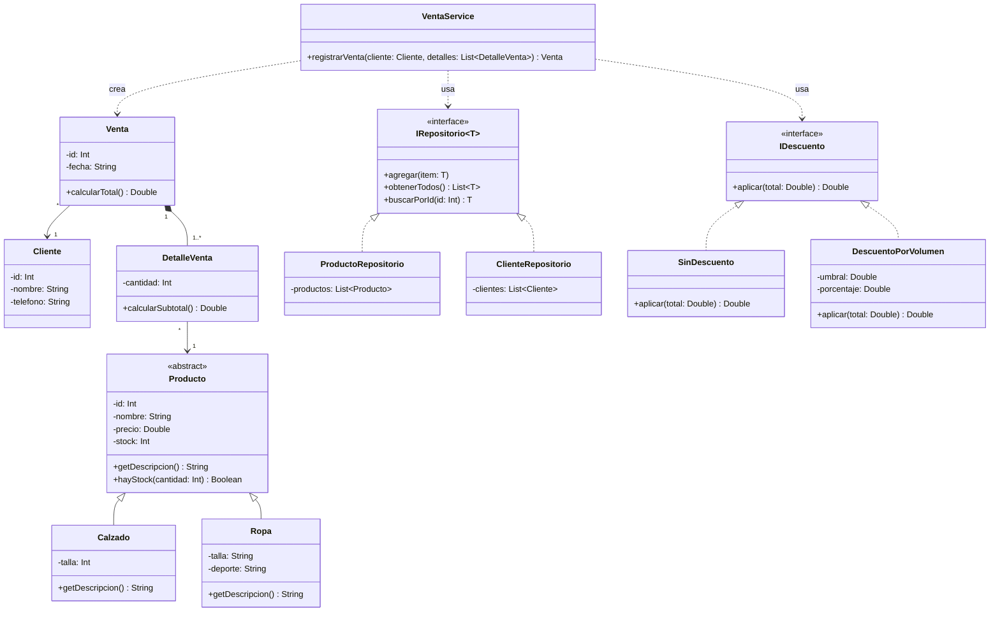

# Prompts utilizados con el agente de Android Studio

Proyecto: **Tienda de Artículos Deportivos** (Kotlin + Jetpack Compose).

Estos son los prompts principales que se usaron, uno por checkpoint, en orden. Todos siguen la misma estructura para reducir errores del agente: **contexto, alcance exacto, reglas de "no tocar" y entregable verificable**.

**Metodología aplicada:**
- Un commit antes de cada prompt, para poder revertir cambios no deseados.
- Compilación (Build → Make Project) entre prompts.
- Prompts pequeños y de alcance cerrado, sin pedir varias cosas a la vez.

---

## Checkpoint 1: Diseño de clases (diagrama UML)

Prompt utilizado:

```text
Necesito que me diseñes un diagrama de clases para una tienda de artículos deportivos. Debe respetar los principios SOLID, no debe ser muy largo, y tiene que ser funcional para un entorno de Android Studio, donde mi tiempo no es mayor a una hora para implementar todas las interacciones.
```

Diagrama resultante (en Mermaid; GitHub lo renderiza automáticamente):



### Aplicación de SOLID

| Principio | Dónde se aplica |
|---|---|
| **S** (responsabilidad única) | `Producto` modela datos y reglas del producto; `VentaService` solo registra ventas; los repositorios solo almacenan y consultan. |
| **O** (abierto/cerrado) | Nuevos descuentos se agregan implementando `IDescuento`, y nuevas categorías heredando de `Producto`, sin modificar `VentaService`. |
| **L** (Liskov) | `Calzado` y `Ropa` son sustituibles por `Producto` con `getDescripcion()` consistente. |
| **I** (segregación de interfaces) | `IRepositorio<T>` e `IDescuento` son interfaces pequeñas y de un solo propósito. |
| **D** (inversión de dependencias) | `VentaService` depende de `IRepositorio` e `IDescuento` (abstracciones), no de clases concretas. |

---

## Checkpoint 2: Implementación en Kotlin (POO + SOLID)

```text
Proyecto Android Kotlin de una tienda de artículos deportivos. Usa el package base que ya existe en el proyecto.

TAREA: implementa SOLO capa de dominio y repositorios, en Kotlin puro (sin Compose, sin Android APIs, sin base de datos). Crea estos archivos en subpaquetes:

model/
- Producto.kt: abstract class Producto(val id: Int, val nombre: String, val precio: Double, var stock: Int) con abstract fun getDescripcion(): String y fun hayStock(cantidad: Int): Boolean
- Calzado.kt: hereda de Producto, agrega val talla: Int, sobrescribe getDescripcion()
- Ropa.kt: hereda de Producto, agrega val talla: String y val deporte: String, sobrescribe getDescripcion()
- Cliente.kt: data class Cliente(val id: Int, val nombre: String, val telefono: String)
- DetalleVenta.kt: class DetalleVenta(val producto: Producto, val cantidad: Int) con fun calcularSubtotal(): Double
- Venta.kt: class Venta(val id: Int, val fecha: String, val cliente: Cliente, val detalles: List<DetalleVenta>) con fun calcularTotal(): Double

repository/
- IRepositorio.kt: interface IRepositorio<T> { fun agregar(item: T); fun obtenerTodos(): List<T>; fun buscarPorId(id: Int): T? }
- ProductoRepositorio.kt y ClienteRepositorio.kt: implementan IRepositorio con una MutableList interna, precargada con 5 productos de ejemplo (mezcla de Calzado y Ropa) y 5 clientes de ejemplo

service/
- IDescuento.kt: interface IDescuento { fun aplicar(total: Double): Double }
- SinDescuento.kt y DescuentoPorVolumen.kt (umbral y porcentaje por constructor)
- VentaService.kt: recibe IRepositorio<Producto> e IDescuento por constructor; fun registrarVenta(cliente: Cliente, detalles: List<DetalleVenta>): Venta que descuenta stock y devuelve la Venta

REGLAS:
- Respeta SOLID: dependencias por interfaces, una responsabilidad por clase.
- NO modifiques build.gradle, AndroidManifest ni archivos existentes que no estén en esta lista.
- NO agregues librerías ni dependencias.
- NO crees UI ni Activities.
- Todo debe compilar sin errores. Al terminar, lista los archivos creados.
```

---

## Checkpoint 4: Diseño de interfaz (Jetpack Compose)

```text
Con las clases ya implementadas (Producto, Calzado, Ropa, Cliente), necesito el DISEÑO de dos pantallas en Jetpack Compose. NO escribas código Kotlin todavía.

Crea el archivo docs/DISENO_INTERFAZ.md en la raíz del proyecto con:

1. Pantalla "Productos": lista de Producto (nombre, descripción, precio, stock).
2. Pantalla "Clientes": lista de Cliente (nombre, teléfono).
3. Navegación entre ambas con una barra inferior.

Para cada pantalla incluye:
- Un boceto en ASCII del layout.
- Una tabla con los componentes de Jetpack Compose a usar (por ejemplo Scaffold, TopAppBar, LazyColumn, Card, Text, NavigationBar, NavHost) y la función de cada uno.
- Los datos que muestra y de qué clase del modelo vienen.

REGLAS:
- Usa solo Material 3.
- NO modifiques ningún archivo .kt, build.gradle ni AndroidManifest.
- Solo crea el .md indicado.
```

---

## Checkpoint 5: Interfaz en Jetpack Compose

```text
Implementa las dos pantallas descritas en docs/DISENO_INTERFAZ.md usando Jetpack Compose y Material 3.

Crea en el subpaquete ui/:
- ProductosScreen.kt: LazyColumn con Card por cada Producto, obtenidos de ProductoRepositorio.obtenerTodos()
- ClientesScreen.kt: LazyColumn con Card por cada Cliente, obtenidos de ClienteRepositorio.obtenerTodos()
- AppNavigation.kt: Scaffold con NavigationBar de 2 ítems (Productos, Clientes) y NavHost con rutas "productos" y "clientes"

Instancia los repositorios una sola vez en MainActivity y pásalos a las pantallas por parámetro. Sin ViewModel, sin Hilt, sin Room.

REGLAS:
- Reutiliza las clases de model/ y repository/ SIN modificarlas.
- Si falta una dependencia (por ejemplo navigation-compose), agrégala SOLO en el build.gradle del módulo app, indicando cuál agregaste, y no cambies versiones existentes.
- Edita MainActivity solo para llamar a AppNavigation dentro de setContent.
- Cada pantalla debe tener un @Preview.
- Debe compilar y ejecutarse en el emulador. Al terminar, lista los archivos creados y modificados.
```
